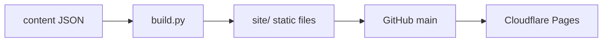

# Valtteri Pertilä CV

A bilingual static CV site generated from structured English and Finnish content.

[Live site](https://cv.valtteri-pertila.workers.dev) · [](https://github.com/valtteripertila/Web-CV/actions/workflows/ci.yml)

## Features

- English and Finnish pages with page-by-page language switching.
- A sticky top bar holds the language and theme controls plus a grouped links menu; the native menu also opens without JavaScript.
- Dark default theme with a light-theme toggle.
- Static HTML generated with Python's standard library.
- Local checks for content, links, HTML, language parity, privacy patterns, theme contrast and build freshness.
- Generated pages use same-origin CSS, JavaScript and images; the local check confirms no external resource loads in HTML or CSS.
- Optional changelog, current-focus page, project write-ups and social preview image.

## How it works



The JSON files are the editable source. Run the generator and commit both the content and generated `site/` files; Cloudflare serves the static output from the repository.

## Project structure

```text
content/                  CV and optional page content
  en.json, fi.json        Translated CV fields and interface text
  shared.json             Name, contact details, site URL and optional repo URL
  timeline.json           Bilingual hackathon, project and role entries
  site_info.json          Site overview and optional AI note
  changelog.json          Bilingual project history
  now.json                Optional current-focus entries
  quality.json            Optional recorded Lighthouse results
build.py                  Content validation and static-site entry point
add.py                    Interactive content-entry helper
tools/check.py            Offline check registry and runner
tools/quality.py          Shared contrast measurement
tools/sitebuilder.py      Page renderers used by build.py
tools/make_og.py           Optional browser-based social image tool
tests/                    Standard-library unit tests
.github/workflows/ci.yml  CI and Lighthouse jobs
site/                     Generated pages and static assets
```

## Quick start

From the repository root:

```sh
python3 build.py
python3 tools/check.py
python3 -m http.server 8000 --directory site
```

On Windows, use `py -3 build.py`, `py -3 tools/check.py`, and `py -3 -m http.server 8000 --directory site`. Open `http://localhost:8000/` to preview the generated site. `python3 build.py --preview-sample` creates isolated, ignored sample pages in `preview/`.

## Editing content

| File | Edit |
| --- | --- |
| `content/shared.json` | Name, initials, email, profile URLs, site domain and optional repository URL |
| `content/en.json`, `content/fi.json` | Translated CV fields, interface text and page slugs |
| `content/timeline.json` | Hackathons, personal projects and roles; newest entries appear first automatically |
| `content/site_info.json` | Site overview and optional AI note |
| `content/changelog.json` | Dated bilingual history entries, newest first |
| `content/now.json` | Current focus; the page is absent while the item list is empty |
| `content/quality.json` | Optional manually measured Lighthouse result |

Use `py -3 add.py hackathon|project|role|media` (or `python3 add.py ...`) to add a timeline entry or media. Media is copied into `site/img/` without overwriting existing files. Use `add.py now` or `add.py changelog` for those entry types. Timeline dates use `YYYY-MM` or `YYYY-MM-DD`; blank end dates mark a current role. Image alt text is required in both languages; captions are optional. Keep images under 1600px and preferably below 300KB. Supported formats are PNG, JPEG, WebP, GIF, SVG and AVIF. Put media paths in timeline JSON relative to `site/img/`; remove the JSON entry and unused image file to remove an image. The Now page is generated only after you enter at least one bilingual item. Timeline filters use native radio controls and CSS, so they work without JavaScript.

The following JSON snippets are README-only illustrations with invented example values. Replace every example value with verified information before adding an entry to the real content files.

**Role example**

```json
{
  "type": "role",
  "employer": "SAMPLE employer",
  "start": "2025-01",
  "end": "",
  "role": {"en": "SAMPLE role", "fi": "SAMPLE tehtävä"},
  "points": {
    "en": ["SAMPLE responsibility"],
    "fi": ["SAMPLE vastuu"]
  }
}
```

**Hackathon example**

```json
{
  "type": "hackathon",
  "date_start": "2025-03-14",
  "date_end": "2025-03-16",
  "event": "SAMPLE event",
  "what": {"en": "SAMPLE event details", "fi": "SAMPLE tapahtuman tiedot"},
  "where": {"en": "SAMPLE venue", "fi": "SAMPLE tapahtumapaikka"},
  "theme": {"en": "SAMPLE theme", "fi": "SAMPLE teema"},
  "team": {"name": "SAMPLE team", "size": 0},
  "role": {"en": "SAMPLE role", "fi": "SAMPLE tehtävä"},
  "result": {"en": "", "fi": ""},
  "project": {
    "title": "SAMPLE build",
    "description": {"en": "SAMPLE description", "fi": "SAMPLE kuvaus"},
    "tags": [],
    "links": {"demo": "", "code": "", "writeup": ""},
    "media": []
  },
  "learned": {"en": "", "fi": ""}
}
```

**Personal project example**

```json
{
  "type": "project",
  "date": "2025-03",
  "title": "SAMPLE project",
  "role": {"en": "", "fi": ""},
  "description": {"en": "SAMPLE description", "fi": "SAMPLE kuvaus"},
  "tags": [],
  "links": {"demo": "", "code": "", "writeup": ""},
  "media": [],
  "learned": {"en": "", "fi": ""}
}
```

## Checks and CI

Run `python3 tools/check.py` locally. It runs content validation, unit tests, local link and fragment resolution, language parity, HTML checks, external-resource and contrast checks, privacy-pattern checks and a temporary-build freshness comparison. The GitHub Actions workflow runs the checks and a Lighthouse audit for both home pages. Actions are not run locally.

The Lighthouse report is an audit result, not a score claim for this site. To record a measurement, run the `lighthouse` job in GitHub Actions and use its uploaded report artifact. In `content/quality.json`, add a `lighthouse` object with the report's `performance`, `accessibility`, `best_practices` and `seo` scores from 0 to 100, the actual `measured_on` date and a short `source` note naming the workflow run. The footer displays these values only when every field is valid; do not enter estimates or reuse the configured minimum thresholds as results.

## Deploying

Cloudflare Pages settings:

- Production branch: `main`
- Framework preset: `None`
- Build command: leave empty
- Build output directory: `site`

For each update, edit the content or code, run `py -3 build.py`, run `py -3 tools/check.py`, review the generated diff, then commit locally. Publish only through the repository's separately authorized deployment workflow.

## Design decisions

- Static output keeps the deployed site simple to host.
- The build and checks use the Python standard library.
- One small theme script handles the dark/light toggle.
- The CSP restricts resource sources to the same origin.
- Content stays separate from page rendering code.
- English and Finnish entries are stored together where they describe the same item.

## Content sources

See [docs/CONTENT_SOURCES.md](docs/CONTENT_SOURCES.md) for the sources behind CV content.
